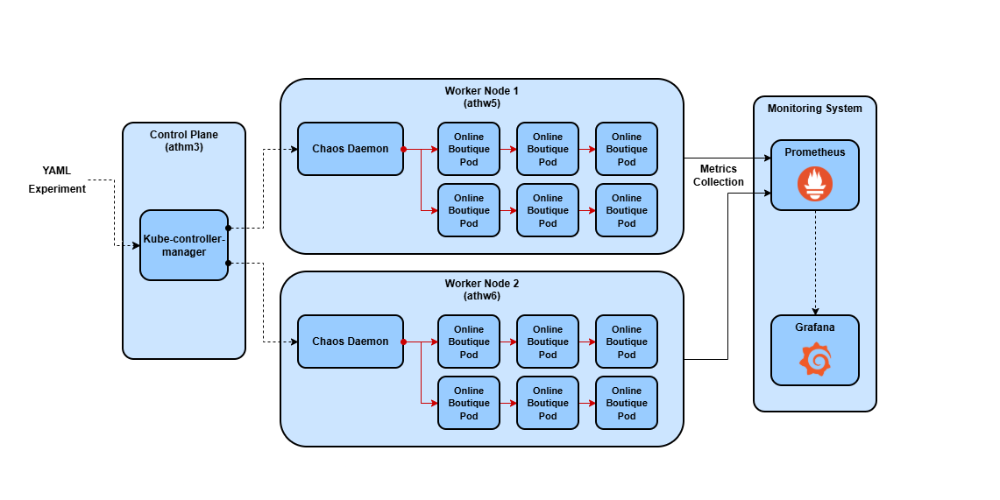
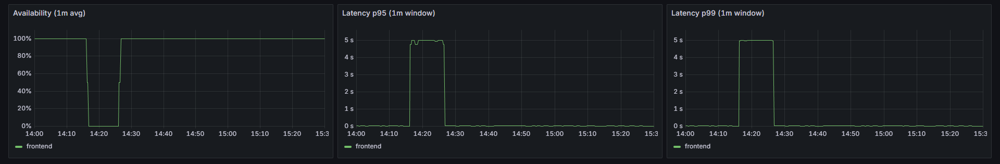
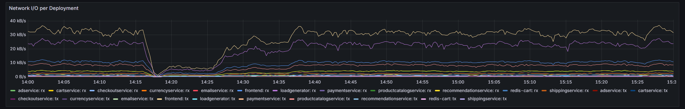
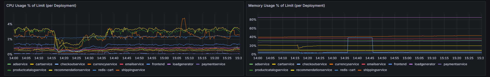

# 🛡️ Kubernetes Resilience Through Chaos Engineering

### Evaluation of Kubernetes Software Reliability Using Chaos Engineering Tools

**Integrated Master's Thesis · 2026**  
**Department of Electrical and Computer Engineering**  
**Democritus University of Thrace (DUTH)**

  
  
  

**Author:** Konstantinos Iatrou  
**Academic supervisor:** Prof. Vassilis Tsaoussidis

---

## 📖 Overview

This thesis investigates the reliability and resilience of Kubernetes-based microservices through controlled **Chaos Engineering experiments**. The study examines how a containerized application responds to pod failures, network degradation, and resource stress, and evaluates how selected Kubernetes resilience mechanisms affect service behavior and recovery.

The experimental workload is **Google Cloud's [Online Boutique](https://github.com/GoogleCloudPlatform/microservices-demo)**, deployed on a self-hosted Kubernetes cluster. The work compares the initial deployment configuration with a modified configuration incorporating additional resilience measures.

> **Scope:** An experimental academic study of Kubernetes fault tolerance and recovery, rather than a production-ready chaos-testing platform.

## 🧭 Research Questions

1. How does **network latency and bandwidth restriction** affect end-to-end performance in a microservices application?
2. How effectively do Kubernetes' built-in mechanisms respond to **pod failures**?
3. What is the impact of **CPU and memory pressure** on co-located services?
4. How do **probes, autoscaling, resource policies, and placement strategies** influence degradation and recovery?

## 🏗️ Experimental Environment

| Component | Setup used in the study |
|:---|:---|
| Cluster | Self-hosted, multi-node Kubernetes (1 control-plane node and 2 worker nodes) |
| Container runtime | containerd |
| Target workload | Google Cloud Online Boutique microservices |
| Fault injection | Chaos Mesh |
| Metrics & monitoring | Prometheus and Grafana |
| Evaluation approach | Baseline experiments followed by experiments with resilience enhancements |

Architecture and experimental workflow from the thesis. The image is displayed if the referenced file is present in the repository.

## 🧪 Chaos Engineering Experiments

The thesis explores three principal categories of injected faults:

| Category | Experiment focus | Observations of interest |
|:---|:---|:---|
| **Pod failures** | Frontend pod termination | Availability, restart behavior, detection and recovery |
| **Network faults** | Added latency and bandwidth restrictions | Tail latency, throughput, service availability |
| **Resource stress** | CPU and memory pressure | Resource utilization, throttling, OOM events, service degradation |

The experiments were followed by a comparison with a configuration incorporating resilience improvements, including:

- **Readiness and liveness probe adjustments**
- **Horizontal Pod Autoscaling (HPA)**
- **Resource requests and limits**
- **Pod Disruption Budgets (PDBs)**
- **Pod anti-affinity policies**

## 📊 Selected Findings

The following figures are **reported in the thesis documentation** and summarize specific experiment settings. They should not be interpreted as performance guarantees for other Kubernetes deployments.

### Network degradation

| Injected condition | Reported observation |
|:---|:---|
| **80 ms added network latency** | Frontend p99 response time: **1,291.94 ms** |
| **300 ms added network latency** | Frontend p99 response time: **4,469.58 ms** |
| **1 Kbps bandwidth limit** | Reported **88.51% throughput reduction** in the corresponding experiment |

These results illustrate how network-level faults can amplify delays across dependent microservices.

### Baseline vs. resilience-enhanced configuration

In the thesis' *moderate complex scenario* involving the advertisement service, the reported values were:

| Metric | Baseline | Resilience-enhanced |
|:---|---:|---:|
| Pod readiness ratio | 0% | 50% |
| p99 latency | 3,151.54 ms | 2,938.42 ms |
| Reported CPU-related utilization metric | 5.24% | 1.07% |

**Interpretation:** The resilience-enhanced configuration showed improved readiness and a lower measured p99 latency in this scenario. The CPU-related percentages are reproduced as reported; they are **not** measurements of electrical power consumption. Pod readiness should also not be confused with end-user request availability.

## 📈 Experiment Visualizations

The thesis includes monitoring figures illustrating recovery and resource behavior during fault injection.

<strong>📉 Availability and response latency</strong>

*Availability and latency during an experiment, as presented in the thesis.*

<strong>🌐 Network throughput</strong>

*Network throughput during fault injection and recovery.*

<strong>⚙️ Node CPU and memory metrics</strong>

*Worker-node resource metrics during the experiments.*

## 🧰 Technologies

  
  
  
  
  

## 📚 Documentation & Reproducibility

This repository accompanies an **Integrated Master's thesis** on Kubernetes reliability and Chaos Engineering. The numerical results and figures correspond to the original experimental setup; reproducing them requires an appropriately configured Kubernetes environment, compatible software versions, and the relevant workload and experiment configurations.

For the detailed experimental procedure, parameter choices, complete measurements, and limitations, refer to the thesis document (*`IatrouK_2026.pdf`*, if included in the repository).

**Note:** This README does not present unverified shell commands or assume that specific deployment manifests are available. Review the repository's actual files before using them to recreate any experiments.

---

**Konstantinos Iatrou**  
*Democritus University of Thrace · Integrated Master's Thesis (2026)*

